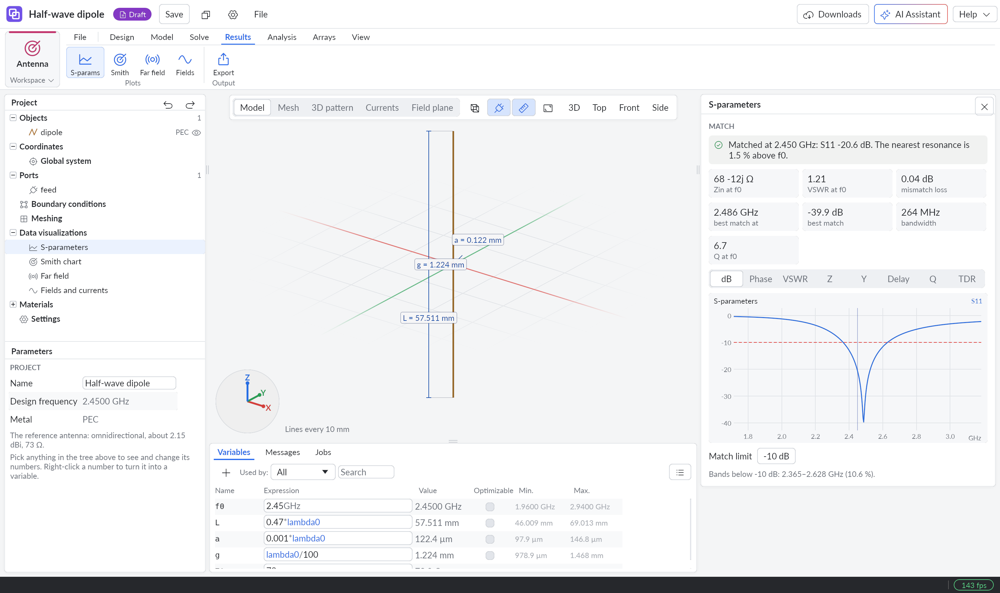
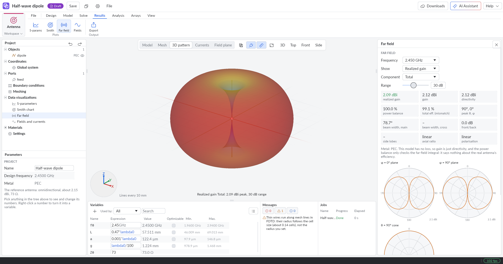

# Sense Sim

**Design antennas with AI.** Describe what you need, then edit the antenna, run a full-wave simulation, and inspect the results in one desktop app.

Open source by [Nextwaves](https://nextwaves.com/en) · [Download for Windows](https://github.com/Nextwaves-Industries/sense-sim/releases) · [MIT License](LICENSE)

Sense Sim is participating in the [Meta Global AI Developer Hackathon](https://dev.meta.ai/events/global-hackathon).

## From a prompt to a working model

Open **AI Assistant** in Antenna Studio and enter this example prompt.

> Design a half-wave dipole for 2.45 GHz with a 73 Ω feed. Keep the length, wire radius, and feed gap editable. Run a simulation and show me the match and radiation pattern.

1. **Describe the antenna.** The assistant turns your brief into design targets and creates a model with named dimensions.
2. **Edit the model.** Change the dimensions in the variable table and save the design as a `.sesim` project.
3. **Solve and refine.** Sense Sim calculates the RF results locally. The assistant can compare them with your targets, adjust the design, and run it again.

The screenshots below show a local solve of the built-in dipole template. At 2.45 GHz, it produced **−20.6 dB S11** and **2.09 dBi peak realized gain**.

## Why Sense Sim?

You know the band, the board, and the space you have. Getting to a first trustworthy result still means choosing a geometry, calculating starting dimensions, defining the feed and materials, setting up a sweep, and figuring out what to change when the match misses the band. Commercial licenses can be a barrier for small teams and independent designers. With openEMS, a free and open-source solver, the standard workflow uses Python or MATLAB/Octave scripts to set up and run the model. [Ansys HFSS](https://www.ansys.com/products/electronics/ansys-hfss) · [CST Studio Suite](https://www.3ds.com/products/simulia/cst-studio-suite) · [openEMS](https://www.openems.de/)

**Give the AI Assistant the engineering brief or a dimensioned sketch.** It can turn your targets into an editable design, run the local solver, check the results against the brief, and use the diagnosis to decide what to change. If the resonance is off or the match is poor, it can revise the geometry and run another solve. You can inspect every dimension, port, and plot in Antenna Studio, take over at any step, or cross-check with openEMS. [Solver benchmarks and limits](docs/fit/README.md)

## What you can do

### AI-assisted design

- Start from a brief, a labelled sketch, or an existing model. Set targets for frequency band, match, realized gain, efficiency, polarization, and size.
- Create editable geometry with named dimensions and units. Calculate starting values, run a solve, diagnose missed targets, and check whether a finer mesh changes the result.
- Explore RFID tag geometries for a specific chip, footprint, substrate, and backing. Compare predicted range and retune for a different material.
- Reconstruct a 3D scene from a site photo, consult the built-in engineering knowledge base, or connect external tools through MCP.

### Antenna Studio

| Area | Features |
| --- | --- |
| **Model** | Start with dipoles, patches, loops, horns, RFID tags, or arrays. Draw conductors, wires, slots, and feeds, add dielectric layers, or import DXF, Gerber, and STL. |
| **Solve** | Use wire and surface method of moments, built-in CPU or GPU finite-difference solving, and optional openEMS cross-checks. Model multiple ports, lumped and probe feeds, and quasi-TEM transmission lines. |
| **Inspect** | View S-parameters, Smith charts, impedance, VSWR, group delay, TDR, near fields, surface currents, 3D radiation patterns, gain, efficiency, and polarization. |
| **Tune** | Run parameter sweeps, optimisation, mesh convergence, sensitivity and Monte Carlo yield studies. Synthesise matching networks and check link budgets, MIMO metrics, and metallic radar cross section. |
| **Switch and steer** | Compare PIN-diode, RF switch, and varactor states. Design phased and hybrid arrays with beam steering, nulls, tapers, quantisation, and coupling from multiport solves. |
| **Test RF systems** | Simulate UHF RFID gate reads and stray reads, direction finding, receiver chains, and FMCW MIMO radar. |
| **Export** | Save editable projects and export Touchstone, far-field data, CSV, HTML reports, Gerber, DXF, and STL. |

[Antenna modelling guide](docs/antenna-3d-modeling.md)

### Sites, positioning, and engineering simulation

- **Build a 3D site.** Place NVIDIA SimReady assets, pose articulated objects, draw walls, set radio materials, import IFC buildings, and export USD scenes.
- **Plan and test positioning.** Deploy UWB, BLE, Wi-Fi, and UHF RFID infrastructure, map coverage, simulate moving tags and zones, and inspect positioning error, blocked links, and alarms. Stream results through OpenEMS Edge, MQTT, Modbus/TCP, webhooks, UDP, or JSONL.
- **Check field performance.** Record predictions with assumptions and uncertainty, plan surveys, fit models to field data, check drift, and score acceptance tests.
- **Run engineering studies.** Simulate structural response, heat transfer, airflow, and electromagnetics on scene objects. [Engineering simulation guide](docs/simulation.md)
- **Model and monitor equipment.** Connect pipes, pumps, shafts, belts, and conveyors. Simulate flow and motion, or monitor real devices and production lines through the Factory workspace.

## Get started

1. Install Sense Sim from [GitHub Releases](https://github.com/Nextwaves-Industries/sense-sim/releases).
2. Choose **Antenna → Design Antenna** to open the design workspace, or pick a ready-to-run project under **Antenna samples**.
3. To use AI, open **Settings → AI assistant**, select **Meta Muse**, and connect your Model API key to use **Muse Spark**. Then open **AI Assistant** from the top bar. [Meta Model API](https://dev.meta.ai/ai)

## Credits

Sense Sim uses [Bevy](https://bevy.org/), [egui](https://github.com/emilk/egui), [openusd for Rust](https://github.com/mxpv/openusd), and [NVIDIA SimReady assets](https://huggingface.co/datasets/nvidia/simready-assets). Engineering studies integrate [Gmsh](https://gmsh.info/), [CalculiX](https://www.calculix.de/), [OpenFOAM](https://dl.openfoam.com/source/v2512/), and [Elmer FEM](https://github.com/ElmerCSC/elmerfem). Vision uses [ONNX Runtime](https://onnxruntime.ai/), and RTLS telemetry can connect to [OpenEMS Edge](https://openems.io/).

Sense Sim's original code is licensed under MIT. Third-party assets and dependencies retain their own terms. [License](LICENSE)
